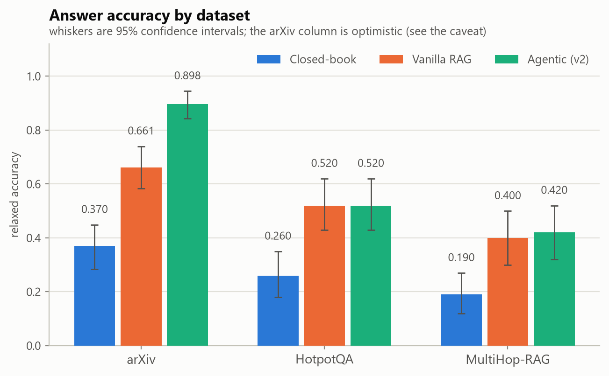
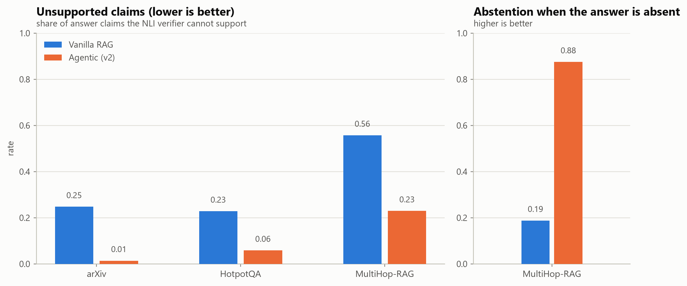
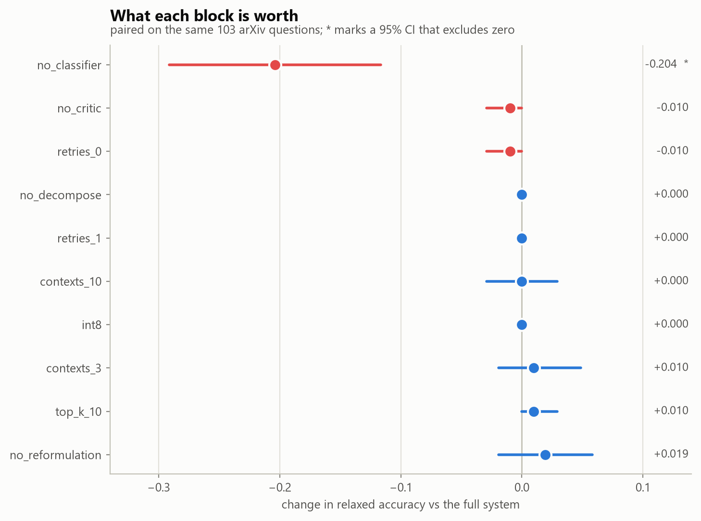
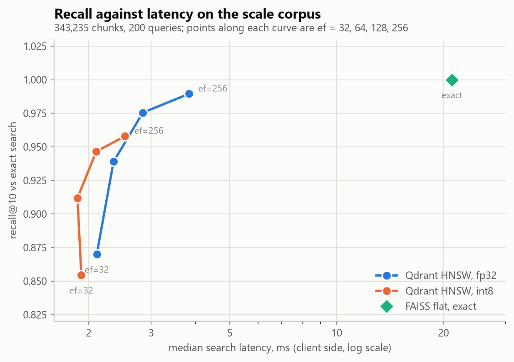

# Agentic RAG with Active Retrieval — results

Every number and figure in this document is generated from the JSON files in `results/` by `scripts/make_report_assets.py`. Nothing here is typed by hand, so the report cannot drift from the measurements it describes. Metrics are reported per dataset and never averaged across them, because the three corpora measure different things.

**Relaxed accuracy** counts an answer correct on exact match, containment, or token F1 >= 0.8 against the reference answer. Intervals are 95% bootstrap intervals.

## 1. Does the agentic pipeline answer better?

<picture>
  <source media="(prefers-color-scheme: dark)" srcset="figures/main_comparison_dark.png">
  
</picture>

| dataset | n | Closed-book | Vanilla RAG | Agentic (v2) |
|---|---|---|---|---|
| arXiv | 127 | 0.370 [0.283, 0.449] | 0.661 [0.583, 0.740] | 0.898 [0.843, 0.945] |
| HotpotQA | 100 | 0.260 [0.180, 0.350] | 0.520 [0.430, 0.620] | 0.520 [0.430, 0.620] |
| MultiHop-RAG | 100 | 0.190 [0.120, 0.270] | 0.400 [0.300, 0.500] | 0.420 [0.320, 0.520] |

**The arXiv column is optimistic and is not the headline result.** The generator used by the agentic system was revised while looking at the arXiv evaluation questions, so its 0.898 against vanilla RAG's 0.661 is partly fitted to its own test set. On the two held-out multi-hop benchmarks, which no part of the system was tuned on, the agentic pipeline and vanilla RAG are tied: their confidence intervals overlap almost completely. The closed-book column is the useful floor — it shows how much of each dataset a 3B model answers from memory alone, which on the arXiv corpus is almost nothing.

On raw accuracy, then, the honest finding is: **retrieval matters enormously, and the agentic machinery on top of it does not by itself answer more questions correctly.** What it does change is the subject of the next section.

## 2. What the agentic pipeline actually buys

<picture>
  <source media="(prefers-color-scheme: dark)" srcset="figures/groundedness_dark.png">
  
</picture>

| dataset | system | unsupported claims | contradicted claims | null abstention | false abstention | skip rate |
|---|---|---|---|---|---|---|
| arXiv | Vanilla RAG | 0.25 | 0.12 | — | 0.24 | 0.00 |
| arXiv | Agentic (v2) | 0.01 | 0.00 | — | 0.01 | 0.41 |
| HotpotQA | Vanilla RAG | 0.23 | 0.16 | — | 0.15 | 0.00 |
| HotpotQA | Agentic (v2) | 0.06 | 0.05 | — | 0.08 | 0.48 |
| MultiHop-RAG | Vanilla RAG | 0.56 | 0.25 | 0.19 | 0.26 | 0.00 |
| MultiHop-RAG | Agentic (v2) | 0.23 | 0.06 | 0.88 | 0.33 | 0.18 |

Two effects here are large, and neither was tuned on the questions it is measured on.

**It abstains when the corpus does not contain the answer.** MultiHop-RAG includes questions whose answer is deliberately absent. Vanilla RAG notices that in 19% of them and invents an answer the rest of the time; the agentic pipeline notices in 88%. That is the sufficiency critic doing the job it was built for: evidence that does not support an answer is rejected rather than summarised.

**Its claims are better supported by the evidence it cites.** On arXiv the NLI verifier cannot support 25% of vanilla RAG's claims against that system's own retrieved contexts, against 1% for the agentic system. RAGAS agrees from a different direction (below). One honest wrinkle: on MultiHop-RAG both systems show high unsupported rates, because answers there are often stitched from several articles and a sentence-level NLI check is strict about that.

### RAGAS on a judged sample

| dataset | system | n judged | faithfulness | answer relevancy |
|---|---|---|---|---|
| arXiv | Vanilla RAG | 40 | 0.688 | 0.336 |
| arXiv | Agentic (v2) | 30 | 0.917 | 0.298 |
| HotpotQA | Vanilla RAG | 42 | 0.512 | 0.266 |
| HotpotQA | Agentic (v2) | 22 | 0.750 | 0.790 |
| MultiHop-RAG | Vanilla RAG | 37 | 0.221 | 0.313 |
| MultiHop-RAG | Agentic (v2) | 24 | 0.251 | 0.557 |

Judged by the Gemini lite models on a sample per dataset, since RAGAS makes many calls per sample and the whole evaluation set does not fit in the free quota. Faithfulness moves the same way as the NLI check. Answer relevancy is noisy and partly measures answer length and phrasing rather than correctness, so it is reported but not leaned on.

## 3. Which blocks earn their place

<picture>
  <source media="(prefers-color-scheme: dark)" srcset="figures/ablation_effects_dark.png">
  
</picture>

| configuration | n | relaxed acc | vs full | 95% CI | significant | model s | lite calls | what changed |
|---|---|---|---|---|---|---|---|---|
| `full` | 103 | 0.903 | (baseline) | — | — | 8.6 | 1.30 | current default (agentic_v2) |
| `no_classifier` | 103 | 0.699 | -0.204 | [-0.291, -0.117] | **yes** | 25.3 | 3.61 | block 1 off: always retrieve |
| `no_critic` | 103 | 0.893 | -0.010 | [-0.029, +0.000] | no | 4.5 | 0.60 | blocks 3-4 off: evidence accepted unjudged |
| `retries_0` | 103 | 0.893 | -0.010 | [-0.029, +0.000] | no | 8.2 | 1.20 | block 4 off: judge once, no retry |
| `no_decompose` | 103 | 0.903 | +0.000 | [+0.000, +0.000] | no | 8.6 | 1.30 | block 2 partial: rewrite only, never split |
| `retries_1` | 103 | 0.903 | +0.000 | [+0.000, +0.000] | no | 8.4 | 1.26 | at most one retry |
| `contexts_10` | 103 | 0.903 | +0.000 | [-0.029, +0.029] | no | 8.4 | 1.30 | 10 chunks shown instead of 6 |
| `int8` | 103 | 0.903 | +0.000 | [+0.000, +0.000] | no | 8.6 | 1.30 | retrieve from the int8-quantized collection |
| `contexts_3` | 103 | 0.913 | +0.010 | [-0.019, +0.049] | no | 6.3 | 1.30 | 3 chunks shown instead of 6 |
| `top_k_10` | 103 | 0.913 | +0.010 | [+0.000, +0.029] | no | 6.2 | 1.30 | retrieve 10 chunks per query instead of 5 |
| `no_reformulation` | 103 | 0.922 | +0.019 | [-0.019, +0.058] | no | 4.3 | 0.61 | block 2 off: search the question as typed |

Each configuration changes exactly one thing and answers exactly the same 103 arXiv questions, so the paired difference is the right comparison.

**Only block 1 has an effect that clears the noise.** Turning the retrieval-necessity classifier off costs -0.204 relaxed accuracy and roughly triples the time per question, and its interval is the only one that excludes zero. Everything else — reformulation, decomposition, the critic, the retry budget, the number of contexts shown, top-k, and int8 quantization — sits inside the noise on these questions.

This deserves plain statement rather than dressing up: **the ablations do not show that the critic and the retry loop improve accuracy.** They show that those blocks are nearly free in accuracy terms while producing the abstention and groundedness behaviour in section 2, which an accuracy metric does not capture. Resolving effects of one or two points would need far more questions than the free quota allowed.

## 4. Block 1: the retrieval-necessity classifier

| split / system | accuracy | macro F1 | retrieve recall | skip rate | n |
|---|---|---|---|---|---|
| classifier, test | 0.892 [0.845, 0.939] | 0.889 | 0.918 | 0.41 | 148 |
| always retrieve, test | 0.574 | 0.365 | 1.000 | 0.00 | 148 |
| classifier, challenge set | 0.800 | 0.799 | 0.860 | 0.44 | 100 |

DistilBERT, fine-tuned on labels produced by experiment rather than by opinion: a question is labelled `skip` when the closed-book model answers it correctly, and `retrieve` when only the retrieval path does. The threshold on P(retrieve) is 0.1592, chosen on the validation split to reach 95% recall on `retrieve`, because a missed retrieval costs more than a wasted search.

The **challenge set** is the honest test: 100 held-out questions written to break the shortcut "research jargon means retrieve" — textbook ML questions phrased with jargon that should be skipped, and questions about corpus facts phrased in plain language that should be retrieved. Accuracy falls from 0.892 on the test split to 0.800 there, so some of the shortcut is real, but it stays well clear of the always-retrieve baseline.

Caveat: the classifier is only properly validated on arXiv-style questions. The benchmark-derived rows in the test split are few and noisy (HotpotQA 10 rows, MultiHop-RAG 11), which is also why the classifier makes no measurable difference on those two datasets.

## 5. The vector store

<picture>
  <source media="(prefers-color-scheme: dark)" srcset="figures/vector_tradeoff_dark.png">
  
</picture>

343235 vectors, 200 queries, top-k 10; recall is measured against exact search.

| configuration | recall@k | client p50 ms | server p50 ms | disk MB |
|---|---|---|---|---|
| `faiss_flat_ip (exact)` | 1.000 | 21.13 | — | — |
| `fp32@ef32` | 0.870 | 2.11 | 0.62 | 1101 |
| `fp32@ef64` | 0.939 | 2.35 | 0.82 | 1101 |
| `fp32@ef128` | 0.975 | 2.84 | 1.17 | 1101 |
| `fp32@ef256` | 0.990 | 3.84 | 1.95 | 1101 |
| `int8@ef32` | 0.855 | 1.91 | 0.45 | 1234 |
| `int8@ef64` | 0.912 | 1.86 | 0.50 | 1234 |
| `int8@ef128` | 0.947 | 2.10 | 0.65 | 1234 |
| `int8@ef256` | 0.958 | 2.53 | 0.94 | 1234 |

HNSW buys roughly an order of magnitude of latency for a few points of recall, and raising `ef` walks back up the recall curve at a predictable cost. int8 scalar quantization is faster again at slightly lower recall and — the counter-intuitive part — **it does not save disk**: Qdrant keeps the quantized vectors alongside the originals, so the int8 collection is the larger of the two on disk. Its benefit is that the small vectors stay resident in RAM (`always_ram`), not storage.

Quantization costs nothing in answer quality: the `int8` ablation in section 3 is identical to the full system.

> **Latency measurements taken in this project before 2026-10-29 were wrong.** The qdrant-client HTTP transport costs about 28 ms per search on this machine while the server reports under 1 ms of search time. Switching to gRPC (`vector_store.prefer_grpc`) took a dev-corpus search from about 15 ms to about 1 ms. The client and server columns above are kept side by side so the remaining client overhead stays visible.

## 6. Latency and cost

| dataset | system | model s | wait s | lite calls | local tokens |
|---|---|---|---|---|---|
| arXiv | Closed-book | 0.5 | 0.0 | 0.00 | 71 |
| arXiv | Vanilla RAG | 0.8 | 0.0 | 0.00 | 1395 |
| arXiv | Agentic (v2) | 8.6 | 0.0 | 1.29 | 907 |
| HotpotQA | Closed-book | 0.5 | 0.0 | 0.00 | 79 |
| HotpotQA | Vanilla RAG | 0.4 | 0.0 | 0.00 | 696 |
| HotpotQA | Agentic (v2) | 11.9 | 0.0 | 1.74 | 558 |
| MultiHop-RAG | Closed-book | 0.7 | 0.0 | 0.00 | 124 |
| MultiHop-RAG | Vanilla RAG | 0.8 | 0.0 | 0.00 | 1191 |
| MultiHop-RAG | Agentic (v2) | 23.3 | 0.0 | 4.22 | 1434 |

`model s` is time spent waiting on a model, `wait s` is time spent sleeping against rate limits, and `lite calls` counts calls to the Gemini lite models. The agentic pipeline costs roughly ten times the local model time of vanilla RAG plus one to four remote judge calls per question, which is the price of the abstention behaviour in section 2.

**Actual monetary cost is $0.** Everything runs on a local Ollama model, local embedding and NLI models, a local Qdrant binary, and the Gemini free tier with billing disabled. The `notional_usd_per_1m_*` fields in the config are deliberately unset, so no invented dollar figure appears anywhere; fill them in to get a paid-tier equivalent.

## 7. What this study does not show

- The arXiv accuracy gain is partly fitted to its own test set (section 1).
- Reformulation, the critic and the retry loop are not individually shown to improve accuracy; only their cost and their effect on abstention are established (section 3).
- Retrieval quality is never measured at scale: the 343k-chunk corpus is used only for the vector benchmark, while every quality number comes from the 528-chunk dev corpus.
- Hybrid retrieval (dense + BM25 + reranker) is implemented and benchmarked but unused, because it did not improve answers.
- A 3B local generator is the ceiling on answer quality; several remaining errors are generation failures on correctly retrieved evidence, not retrieval failures.
- **Nothing guards the skip path.** Blocks 3-6 only protect answers that went through retrieval: when block 1 decides to skip, the generator answers from memory, there are no contexts, and the verifier returns `no_contexts` rather than a judgement. A question the classifier wrongly routes to skip is therefore answered with no critic, no citations and no verification — observed directly when a factual question outside the corpus was skipped and answered with a confident, unverifiable number. The abstention results in section 2 describe the retrieval path only.
- The judge and verifier-fallback roles are limited to one model at 20 requests a day, because the originally planned model was withdrawn by the provider.
- Every evaluation set is small (100-127 questions), so differences of a few points are not resolvable.
